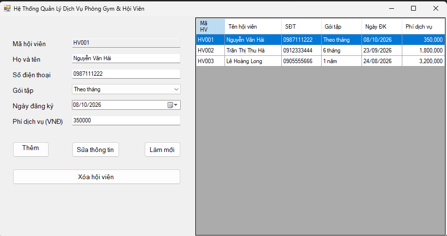
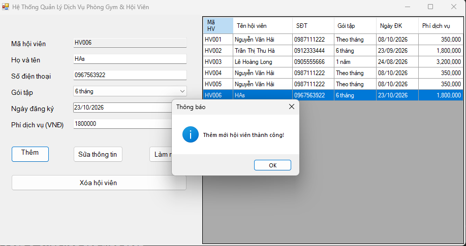
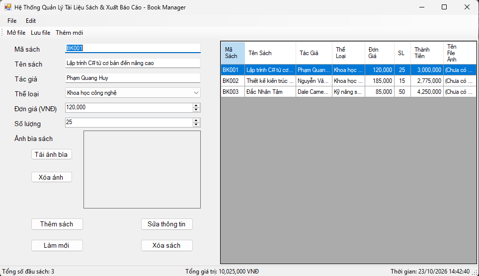
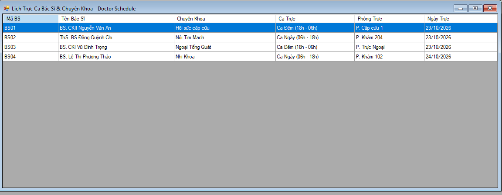
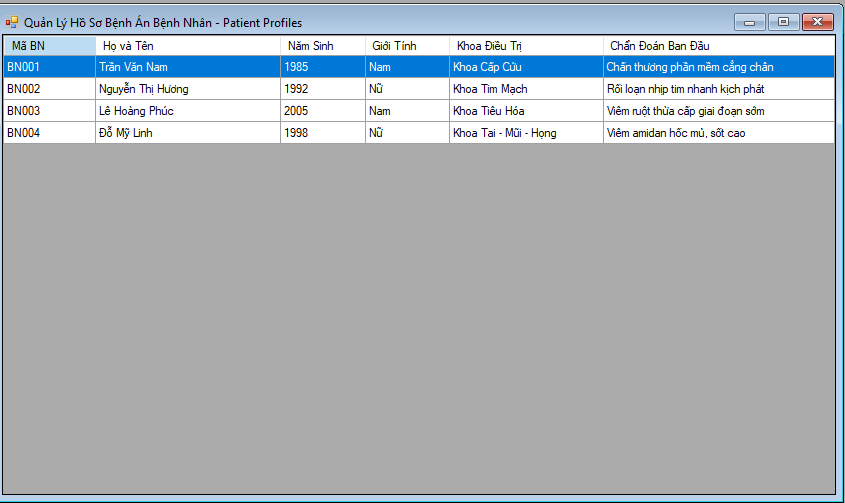
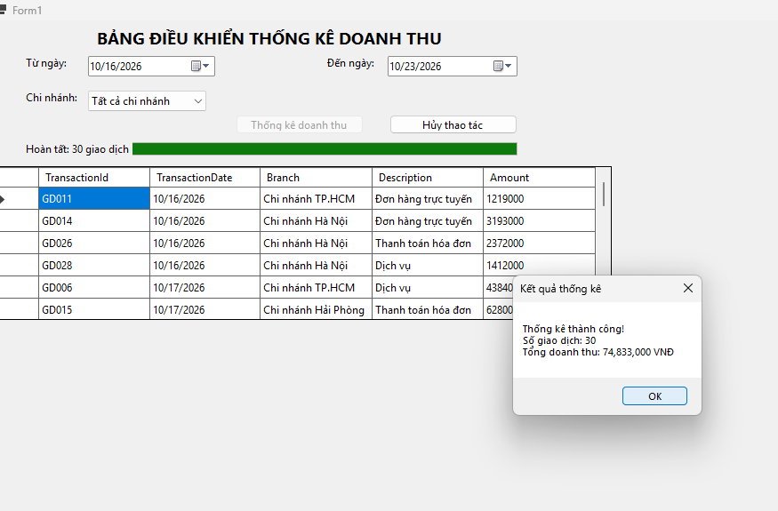
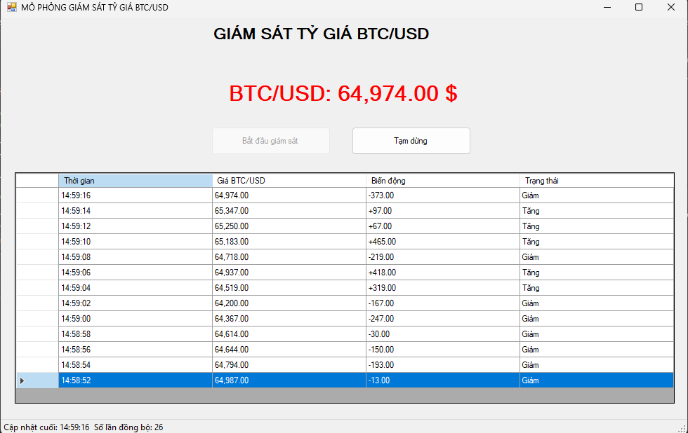

# BÁO CÁO BÀI TẬP THỰC HÀNH LẬP TRÌNH C# WINFORMS

## I. THÔNG TIN SINH VIÊN

- **Họ và tên:** Bùi Thanh Bình
- **Mã số sinh viên:** 24810320641
- **Lớp học phần:** Lập trình .NET

- **Link Repository:** https://github.com/binhthanhbui8-create/BuiThanhBinh-24810320641-Test_2.git

---

## II. DANH SÁCH BÀI TẬP HOÀN THÀNH & TỰ ĐÁNH GIÁ

| Bài tập | Tiêu đề bài tập | Trạng thái | Mức độ hoàn thành (%) |
| :---: | :--- | :---: | :---: |
| **Bài 1** | Quản lý Dịch vụ Phòng Gym & Hội viên | Hoàn thành | 100% |
| **Bài 2** | Quản lý Tài liệu Sách & Xuất Báo cáo Nhà sách | Hoàn thành | 100% |
| **Bài 3** | Hệ thống MDI Quản lý Bệnh viện & Truy xuất Hồ sơ Bệnh án | Hoàn thành | 100% |
| **Bài 4** | Bảng Điều khiển Thống kê Doanh thu Multi-Threading | Hoàn thành | 100% |
| **Bài 5** | Mô phỏng Giám sát Tỷ giá Tài chính Thời gian thực | Hoàn thành | 100% |

---

## III. MINH HỌA GIAO DIỆN & KỸ THUẬT NỔI BẬT

### 1. Bài 1: Quản lý Dịch vụ Phòng Gym & Hội viên
- **Kỹ thuật áp dụng:** Cấu hình `DataGridView` bằng code (`AutoGenerateColumns = false`), Data Binding 2 chiều với `BindingList<T>` và `BindingSource`, Validation nâng cao với `ErrorProvider`.
- **Hình ảnh minh họa Giao diện:**

\
*Mô tả: Giao diện chính hiển thị DataGridView và đồng bộ dữ liệu 2 chiều lên các TextBox.*

\
*Mô tả: Kiểm tra hợp lệ dữ liệu nhập vào bằng ErrorProvider khi nhấn Thêm mới.*

---

### 2. Bài 2: Quản lý Tài liệu Sách & Xuất Báo cáo Nhà sách
- **Kỹ thuật áp dụng:** `OpenFileDialog` (Tải ảnh bìa sách), `SaveFileDialog` / `OpenFileDialog` (Đọc/Ghi định dạng CSV), quản lý trạng thái qua `MenuStrip`, `ToolStrip` và `StatusStrip`.
- **Hình ảnh minh họa Giao diện:**

\
*Mô tả: Chọn ảnh bìa sách hiển thị lên PictureBox và nạp/xuất dữ liệu file CSV.*

---

### 3. Bài 3: Hệ thống MDI Quản lý Bệnh viện & Truy xuất Hồ sơ Bệnh án
- **Kỹ thuật áp dụng:** Kiến trúc đa cửa sổ MDI Container, quản lý vòng đời Form con, chống mở trùng lặp (Duplicate), điều hướng cửa sổ (Cascade, Tile Horizontal/Vertical).
- **Hình ảnh minh họa Giao diện:**

\
\
*Mô tả: Khung Form cha MDI điều khiển mở các Form con hồ sơ bệnh nhân và lịch trực bác sĩ.*

---

### 4. Bài 4: Bảng Điều khiển Thống kê Doanh thu Multi-Threading
- **Kỹ thuật áp dụng:** Lập trình bất đồng bộ với `async/await` và `Task.Run`, giữ giao diện mượt mà không bị treo (`Not Responding`), quản lý hủy tiến trình bằng `CancellationTokenSource`.
- **Hình ảnh minh họa Giao diện:**

\
*Mô tả: Tiến trình thống kê chạy ngầm với ProgressBar và nút Hủy thao tác linh hoạt.*

---

### 5. Bài 5: Mô phỏng Giám sát Tỷ giá Tài chính Thời gian thực
- **Kỹ thuật áp dụng:** Tiến trình ngầm lặp định kỳ (`Background Loop`), tuân thủ tuyệt đối quy tắc Thread Safety trong WinForms sử dụng `this.InvokeRequired` và `this.Invoke()`.
- **Hình ảnh minh họa Giao diện:**

\
*Mô tả: Giám sát tỷ giá thời gian thực cập nhật an toàn lên UI và ghi nhật ký vào DataGridView.*

---